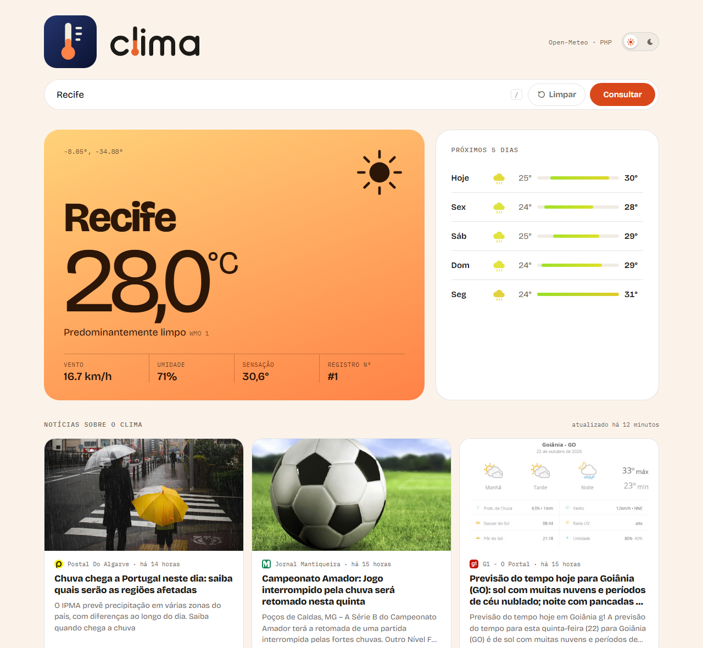

<p align="center">
  
</p>

<h1 align="center">clima</h1>

<p align="center">
  Consulte o clima de qualquer cidade, veja a previsão de 5 dias e acompanhe as notícias de meteorologia, tudo numa página só.
</p>

<p align="center">
  <a href="https://clima-app-three-roan.vercel.app"><b>Ver o site no ar</b></a> ·
  <a href="#como-rodar-o-projeto">Como rodar</a> ·
  <a href="#api">API</a>
</p>

<p align="center">
  <picture>
    <source media="(prefers-color-scheme: dark)" srcset="docs/imagens/site-escuro.png">
    
  </picture>
</p>

---

## Objetivo do projeto

O **clima** é um projeto de portfólio. Ele resolve um problema simples, saber como está o tempo numa cidade e o que está acontecendo com o clima no país, e serve para praticar as partes que aparecem em qualquer sistema real:

- **Integrar APIs de terceiros.** Três chamadas encadeadas: geocodificação (nome → coordenadas), previsão do tempo e notícias.
- **Proteger credenciais.** A chave da API de notícias fica só no servidor. O navegador nunca a vê.
- **Respeitar limites de uso.** O plano gratuito de notícias permite 200 chamadas por dia. Com cache, o site funciona com qualquer número de visitas.
- **Tratar dados de fontes externas.** As notícias chegam com duplicatas, HTML e resultados fora do tema. Antes de ir para a tela, elas são filtradas e limpas.
- **Construir uma interface completa sem framework.** HTML, CSS e JavaScript puros, com tema claro e escuro, animações, layout responsivo e acessibilidade.
- **Publicar com deploy contínuo.** Cada push no GitHub atualiza o site na Vercel automaticamente.

## Funcionalidades

- **Busca por cidade:** temperatura, sensação térmica, umidade, vento e condição do céu.
- **Painel que reage ao clima:** a cor muda conforme o tempo (sol, noite, nuvens, névoa, chuva, neve, tempestade), com partículas de chuva e neve e relâmpagos.
- **Previsão de 5 dias:** barras de mínima e máxima numa escala comum.
- **Notícias de meteorologia em português:** atualizadas a cada 15 minutos.
- **Histórico da visita:** as consultas ficam numa tabela até a aba ser fechada. Nada é gravado.
- **Tema claro e escuro.**
- **Atalhos:** `/` foca a busca e `Esc` limpa a consulta.
- **Acessibilidade:** respeita a opção do sistema de reduzir animações.

## Tecnologias

| Camada | O que foi usado |
| --- | --- |
| Back-end | PHP 8 (sem framework), endpoints JSON |
| Front-end | HTML, CSS (variáveis, temas, `color-mix`), JavaScript, [GSAP](https://gsap.com/) para animações |
| Dados | [Open-Meteo](https://open-meteo.com/) (clima, sem chave) e [NewsData.io](https://newsdata.io/) (notícias) |
| Deploy | Vercel com o runtime [`vercel-php`](https://github.com/vercel-community/php), integrado ao GitHub |

## Como rodar o projeto

### Pré-requisitos

- **PHP 8 ou superior** com `allow_url_fopen` habilitado. O [XAMPP](https://www.apachefriends.org/) já vem pronto.
- **Git**
- **(Opcional) Chave gratuita da [NewsData.io](https://newsdata.io/register)** para a seção de notícias. Sem ela, o resto do site funciona normalmente.

### Passo a passo

**1. Clone o repositório**

```bash
git clone https://github.com/BrunoSilveira100/clima-app.git
cd clima-app
```

**2. Configure a chave de notícias (opcional)**

Copie o arquivo de exemplo e troque `SUA_CHAVE` pela sua chave:

```bash
# Windows
copy api\_local.exemplo.php api\_local.php

# Linux / macOS
cp api/_local.exemplo.php api/_local.php
```

O `api/_local.php` está no `.gitignore`: a chave nunca vai para o GitHub.

**3. Suba o servidor**

```bash
php -S localhost:8000
```

> No Windows com XAMPP, se o comando `php` não for reconhecido, use o caminho completo: `C:\xampp\php\php.exe -S localhost:8000`

**4. Abra no navegador:** http://localhost:8000

**Alternativa com Apache (XAMPP):** coloque a pasta em `C:\xampp\htdocs\clima-app`, inicie o Apache no painel do XAMPP e acesse http://localhost/clima-app.

### Testando a API

Com o servidor rodando:

```bash
curl "http://localhost:8000/api/clima.php?cidade=Manaus"
curl "http://localhost:8000/api/noticias.php"
```

A pasta [`docs/postman`](docs/postman) tem uma coleção do Postman com os casos de sucesso e de erro.

### Publicando a sua cópia

Importe o repositório na [Vercel](https://vercel.com/new) (Framework Preset: **Other**) e cadastre a variável de ambiente `NEWSDATA_API_KEY`. O `vercel.json` já configura o PHP.

## API

| Rota | O que retorna | Erros |
| --- | --- | --- |
| `GET /api/clima.php?cidade=Manaus` | Clima atual e previsão de 5 dias | `400` cidade vazia · `404` cidade não encontrada · `502` Open-Meteo fora do ar |
| `GET /api/noticias.php` | Até 6 notícias de meteorologia | `503` chave não configurada · `502` NewsData.io fora do ar e sem cache |

<details>
<summary>Exemplo de resposta de <code>/api/clima.php</code></summary>

```json
{
  "cidade": "Manaus",
  "latitude": -3.1019,
  "longitude": -60.025,
  "clima": {
    "temperatura_c": 29.4,
    "vento_kmh": 8.2,
    "codigo_clima": 2,
    "dia": true,
    "umidade": 74,
    "sensacao_c": 33.1
  },
  "previsao": [
    { "data": "2026-10-04", "temp_max": 32.1, "temp_min": 24.5, "codigo": 2 }
  ]
}
```
</details>

## Decisões técnicas

- **A chave fica no servidor.** O navegador chama `api/noticias.php`, e só o PHP fala com a NewsData.io. A chave vem de variável de ambiente na Vercel ou de um arquivo fora do Git na máquina local.
- **Cache de 15 minutos.** O site faz no máximo cerca de 96 chamadas por dia à NewsData.io, abaixo do limite gratuito de 200. Se a API cair ou a cota acabar, a última resposta boa continua sendo exibida.
- **Busca no título, não no texto.** Procurar "clima" no texto inteiro trazia política ("clima de eleição") e horóscopo. A busca usa termos de meteorologia (chuva, temporal, frente fria, onda de calor…) só no título.
- **Limpeza dos dados.** Deduplicação por título, remoção de HTML, aceitação só de links `http(s)` (bloqueia `javascript:`) e datas normalizadas.
- **Sem XSS.** Todo texto externo entra na página por `textContent`, nunca por `innerHTML`.
- **Sem banco de dados.** O histórico vive só na memória da página. Nada pessoal é armazenado.

## Estrutura

```
clima-app/
├── index.html              # estrutura da página
├── assets/
│   ├── css/estilos.css     # estilos e temas
│   ├── js/app.js           # busca, animações, previsão, notícias e histórico
│   └── img/                # logo e ícone
├── api/
│   ├── clima.php           # Open-Meteo: geocodificação + previsão
│   ├── noticias.php        # NewsData.io: busca, cache e limpeza
│   └── _local.exemplo.php  # modelo do arquivo de chave local
├── docs/
│   ├── identidade-visual/  # estudos de logo em SVG
│   ├── imagens/            # prints usados neste README
│   └── postman/            # coleção para testar a API
└── vercel.json             # PHP na Vercel
```

## Autor

Feito por **Bruno Silveira** · [GitHub](https://github.com/BrunoSilveira100)
