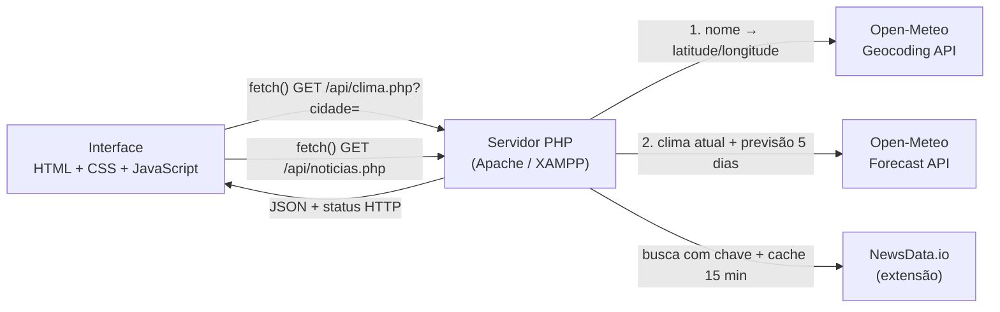

<p align="center">
  
</p>

<h1 align="center">Consulta de Clima · API Open-Meteo</h1>

<p align="center">
  Trabalho 1 — <b>Consumindo APIs públicas</b><br>
  Linguagem de Programação VIII · Ciência da Computação, 8º período · UNIFEG
</p>

<p align="center">
  <a href="https://clima-app-three-roan.vercel.app"><b>Ver a aplicação no ar</b></a> ·
  <a href="#como-rodar-no-xampp">Como rodar no XAMPP</a> ·
  <a href="#diagrama-do-fluxo">Diagrama do fluxo</a>
</p>

---

## Sobre o trabalho

| | |
| --- | --- |
| **Disciplina** | Linguagem de Programação VIII |
| **Curso** | Ciência da Computação — 8º período — UNIFEG |
| **Professor** | José Bruno de Oliveira |
| **Autor** | Bruno Henrique Silveira |
| **API sorteada** | [Open-Meteo](https://open-meteo.com/) — previsão do tempo por cidade |

**Objetivo:** construir uma aplicação que consome uma API pública e demonstrar o entendimento do **caminho dos dados entre cada camada**: interface → servidor PHP → API pública, com testes no Postman. O foco do trabalho é o fluxo, e não a aparência da tela.

**O que a aplicação faz:** o usuário digita o nome de uma cidade. O servidor PHP descobre as coordenadas dela na Geocoding API da Open-Meteo, consulta o clima atual e a previsão de 5 dias e devolve tudo em JSON para a interface. Como extensão, a página também mostra notícias de meteorologia vindas da NewsData.io.

## Diagrama do fluxo



**Regra seguida:** a interface **nunca** chama a API pública diretamente. Toda comunicação externa passa pelo servidor PHP.

### Por que o front não chama a API diretamente?

1. **Segurança das credenciais.** A chave da NewsData.io fica só no servidor. Se a chamada partisse do navegador, qualquer pessoa leria a chave no DevTools.
2. **Validação no servidor.** O PHP valida o parâmetro `cidade` antes de chamar a API externa. A validação do front pode ser contornada.
3. **Respostas padronizadas.** O servidor devolve JSON e status HTTP coerentes (400, 404, 502), independentemente do formato de cada API externa.
4. **Controle de uso.** O servidor guarda as notícias em cache por 15 minutos, respeitando a cota do plano gratuito (200 requisições por dia).
5. **Desacoplamento.** Trocar de API ou mudar a lógica não exige alterar a interface.

## Endpoints do servidor

| Método | Rota | Descrição | Status |
| --- | --- | --- | --- |
| `GET` | `/api/clima.php?cidade={nome}` | Geocodifica a cidade e devolve o clima atual e a previsão de 5 dias | `200` sucesso · `400` parâmetro vazio · `404` cidade não encontrada · `502` falha na Open-Meteo |
| `GET` | `/api/noticias.php` | Até 6 notícias de meteorologia, limpas e em cache | `200` sucesso · `502` falha na NewsData.io · `503` chave não configurada |
| `GET` | `/api/ranking.php` | As 5 cidades mais pesquisadas por todos os visitantes | `200` (lista vazia se o ranking ainda não tiver dados) |

<details>
<summary>Exemplo de resposta de <code>/api/clima.php?cidade=Manaus</code></summary>

```json
{
  "cidade": "Manaus",
  "latitude": -3.1019,
  "longitude": -60.025,
  "clima": {
    "temperatura_c": 29.4,
    "vento_kmh": 8.2,
    "codigo_clima": 2,
    "dia": true,
    "umidade": 74,
    "sensacao_c": 33.1,
    "chuva_pct": 15
  },
  "previsao": [
    {
      "data": "2026-10-04", "temp_max": 32.1, "temp_min": 24.5, "codigo": 2, "chuva_pct": 40,
      "nascer_sol": "05:41", "por_sol": "17:52", "chuva_mm": 3.2, "chuva_horas": 4,
      "vento_max_kmh": 18.5, "uv_max": 9.3
    }
  ]
}
```
</details>

## Probabilidade de chuva

A chance de chuva aparece em três lugares da interface e vem de dois campos da Open-Meteo.

| Campo da resposta | Parâmetro pedido à Open-Meteo | Significado |
| --- | --- | --- |
| `clima.chuva_pct` | `current=precipitation_probability` | Chance de precipitação no momento da consulta |
| `previsao[].chuva_pct` | `daily=precipitation_probability_max` | **Maior** chance horária de precipitação ao longo do dia |

Os dois valores são inteiros de 0 a 100. Se a Open-Meteo não enviar o dado, a API devolve `null` e a interface mostra "–".

**Onde aparece na interface**

| Local | O que mostra |
| --- | --- |
| Card do clima | Métrica **Chuva**, a primeira da linha (antes de umidade, vento e sensação) |
| Próximos 5 dias | Gota e porcentagem em cada dia |
| Suas últimas consultas | Coluna **Chuva**, com o valor congelado no momento de cada consulta |

Na previsão e na tabela, a gota fica **azul a partir de 50%** (classe `.chuva.alta`) e atenuada abaixo disso. A regra é a mesma nos dois lugares, para manter uma leitura visual única.

**Decisões e limitações**

- **Máximo diário, não média.** É o critério usado pelos principais apps de clima. Um dia com uma pancada rápida à tarde aparece com chance alta, mesmo que o resto do dia seja seco.
- **Divergência com outras fontes é esperada.** Cada provedor usa modelos meteorológicos diferentes. Na mesma cidade e na mesma hora, a Open-Meteo pode indicar 98% e outro serviço, 15%, principalmente com tempestades isoladas. A aplicação mostra fielmente o valor calculado pela Open-Meteo.
- **Sem custo extra de requisição.** Os campos novos entram na mesma chamada que já buscava o clima atual e a previsão.

## Detalhes do dia

Cada dia da previsão é clicável (mouse, toque ou teclado com Enter ou espaço). Ao selecionar um dia, um painel abaixo da lista mostra informações que a linha resumida não comporta. "Hoje" já começa selecionado.

| Informação | Campo da resposta | Parâmetro da Open-Meteo | Apoio à leitura |
| --- | --- | --- | --- |
| Nascer e pôr do sol | `nascer_sol`, `por_sol` | `daily=sunrise,sunset` | Horas de luz calculadas na interface |
| Chuva acumulada | `chuva_mm`, `chuva_horas` | `daily=precipitation_sum,precipitation_hours` | "dia seco" quando não há horas de chuva |
| Vento máximo | `vento_max_kmh` | `daily=wind_speed_10m_max` | fraco (< 20), moderado (< 40), forte (< 62), muito forte |
| Índice UV máximo | `uv_max` | `daily=uv_index_max` | Selo colorido e recomendação pela escala da OMS: baixo, moderado, alto, muito alto, extremo |

### Previsão hora a hora

Abaixo dos detalhes, uma faixa com **rolagem horizontal** mostra o dia selecionado hora a hora: horário, ícone (lua à noite), temperatura com uma curva ligando os pontos, chance de chuva e barras com os milímetros de chuva de cada hora. No dia de hoje, a faixa começa em **"Agora"**, a hora atual da cidade (`clima.hora_local`). Nos outros dias, mostra as 24 horas.

Acima da faixa, um aviso resume a janela de chuva: "Leve guarda-chuva: chuva mais provável das 17h às 23h". Contam as horas com chance ≥ 50% ou ≥ 0,5 mm. Para rolar, funcionam o toque (celular), a roda do mouse, arrastar com o mouse e as setas do teclado. Um esmaecido na borda direita indica que há mais horários.

| Campo (`previsao[].horas[]`) | Parâmetro da Open-Meteo |
| --- | --- |
| `hora`, `temp` | `hourly=temperature_2m` |
| `chuva_pct`, `chuva_mm` | `hourly=precipitation_probability,precipitation` |
| `codigo`, `dia` | `hourly=weather_code,is_day` |

A API agrupa as 120 horas (5 dias × 24 h) por data. A resposta completa fica em torno de 11 KB, e continua sendo uma única chamada à Open-Meteo.
Os horários vêm no fuso da cidade consultada (`timezone=auto`). Os campos novos chegam na mesma requisição da previsão, sem chamadas extras. O motivo de incluir o UV: um dia com 0% de chuva pode ter índice UV 9 ("muito alto"), e essa informação não aparecia em nenhum outro lugar da tela.

## Testes no Postman

A coleção exportada está em [`docs/postman/clima-app.postman_collection.json`](docs/postman/clima-app.postman_collection.json). Ajuste a variável `baseUrl` para o endereço do seu servidor.

| # | Requisição | Método | Status esperado |
| --- | --- | --- | --- |
| 1 | Direto na API pública Open-Meteo (Manaus) | `GET` | `200` |
| 2 | Servidor: consultar o clima de uma cidade | `GET` | `200` |
| 3 | Servidor: últimas notícias sobre o clima | `GET` | `200` |
| 3b | Servidor: cidades mais pesquisadas | `GET` | `200` |
| 4 | **Erro proposital:** cidade inexistente (`xqzptw`) | `GET` | `404` |
| 5 | **Erro proposital:** parâmetro `cidade` vazio | `GET` | `400` |

## Como rodar no XAMPP

### Pré-requisitos

- [XAMPP](https://www.apachefriends.org/) com **PHP 8 ou superior** (a opção `allow_url_fopen` já vem habilitada).
- Acesso à internet, porque o servidor consulta as APIs externas.
- (Opcional) Uma chave gratuita da [NewsData.io](https://newsdata.io/register) para a seção de notícias. Sem ela, a consulta do clima funciona normalmente.

### Passo a passo

1. **Baixe o projeto para dentro do `htdocs` do XAMPP:**

   ```bash
   cd C:\xampp\htdocs
   git clone https://github.com/BrunoSilveira100/Consulta-de-Clima-API-Open-Meteo.git
   ```

   Ou baixe o ZIP pelo GitHub (**Code → Download ZIP**) e extraia em `C:\xampp\htdocs`.

2. **(Opcional) Configure a chave de notícias.** Dentro da pasta `api`, copie `_local.exemplo.php` para `_local.php` e troque `SUA_CHAVE` pela sua chave. O arquivo `_local.php` está no `.gitignore`, então a chave não vai para o GitHub.

3. **Abra o painel do XAMPP e inicie o Apache.**

4. **Acesse no navegador:**

   ```
   http://localhost/Consulta-de-Clima-API-Open-Meteo/
   ```

5. **Teste a API pelo navegador ou pelo Postman:**

   ```
   http://localhost/Consulta-de-Clima-API-Open-Meteo/api/clima.php?cidade=Manaus
   ```

**Sem XAMPP:** com o PHP instalado, rode `php -S localhost:8000` dentro da pasta do projeto e acesse http://localhost:8000.

## Boas práticas aplicadas

- **Validação no servidor:** parâmetro vazio retorna `400`, mesmo que o front também valide.
- **Status HTTP coerentes** para sucesso, parâmetro inválido, item não encontrado e falha da API externa.
- **Nenhuma credencial no JavaScript:** a chave da API fica em variável de ambiente (Vercel) ou em arquivo fora do Git (local).
- **Erros com mensagem amigável na interface,** sem `alert()` e sem quebrar a página.
- **Proteção contra XSS:** todo dado vindo de fora entra na página por `textContent`, nunca por `innerHTML`.
- **Limpeza dos dados externos:** as notícias passam por deduplicação, remoção de HTML, validação de links (só `http(s)`) e normalização de datas.

## Cidades mais pesquisadas

Os botões da tela inicial mostram as **5 cidades mais pesquisadas por todos os visitantes**. Quando o ranking ainda tem menos de 5 cidades, a lista é completada com sugestões padrão.

- **Onde conta:** no servidor (`api/clima.php`), e só quando a cidade é encontrada. Pesquisas inválidas não entram no ranking.
- **Qualidade do dado:** a contagem usa o nome oficial devolvido pela geocodificação, então "guaxupe", "GUAXUPE" e "Guaxupé" somam na mesma cidade.
- **Armazenamento:** na Vercel, um *sorted set* no Redis (`ZINCRBY` para somar, `ZREVRANGE` para o top 5). O código aceita a variável `REDIS_URL` (conexão TCP pelo protocolo nativo do Redis, com senha e TLS opcional) ou a API REST da Upstash. No XAMPP, usa o arquivo `data/ranking.json`, com trava (`flock`) para gravações simultâneas não perderem contagens.
- **Privacidade:** só o nome da cidade e um contador. Nenhum dado de quem pesquisou.
- **Resiliência:** se o ranking falhar, a consulta do clima continua funcionando e os botões voltam às sugestões padrão.

## Sobre o banco de dados

A versão entregue do trabalho gravava cada consulta numa tabela MySQL (`consultas_clima`) com prepared statements e tinha um endpoint para listar os registros salvos.

**Este repositório é a versão de portfólio**, evoluída a partir do trabalho. Nela o banco relacional foi removido de propósito: o histórico de consultas fica só na página aberta e some ao fechar a aba, sem guardar dados dos visitantes. O único dado persistido é o contador anônimo do ranking de cidades. A arquitetura em camadas foi mantida (interface → servidor → API).

## Estrutura do projeto

```
Consulta-de-Clima-API-Open-Meteo/
├── index.html              # interface (estrutura)
├── assets/
│   ├── css/estilos.css     # estilos, tema claro/escuro e cores por clima
│   ├── js/app.js           # fetch() no servidor, renderização e animações
│   └── img/                # logo e ícone
├── api/
│   ├── clima.php           # Open-Meteo: geocodificação + previsão
│   ├── noticias.php        # NewsData.io: busca, cache e limpeza
│   ├── ranking.php         # top 5 cidades mais pesquisadas
│   ├── _ranking.php        # contagem do ranking (Redis ou arquivo local)
│   └── _local.exemplo.php  # modelo do arquivo de chave local
├── docs/
│   └── postman/            # coleção do Postman (.json)
└── vercel.json             # publicação na Vercel
```

## Tecnologias

PHP 8 · HTML · CSS · JavaScript · [GSAP](https://gsap.com/) (animações) · Open-Meteo · NewsData.io · Postman · XAMPP · Vercel

## Referências

- Open-Meteo — documentação: https://open-meteo.com/en/docs
- Open-Meteo — repositório oficial: https://github.com/open-meteo/open-meteo
- IETF. RFC 9110 — HTTP Semantics: https://www.rfc-editor.org/rfc/rfc9110
- MDN Web Docs — Métodos de requisição HTTP: https://developer.mozilla.org/pt-BR/docs/Web/HTTP/Methods

---

<p align="center">
  Bruno Henrique Silveira · <a href="https://github.com/BrunoSilveira100">GitHub</a> · Linguagem de Programação VIII · UNIFEG
</p>
